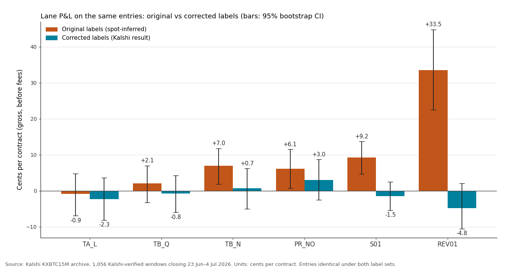
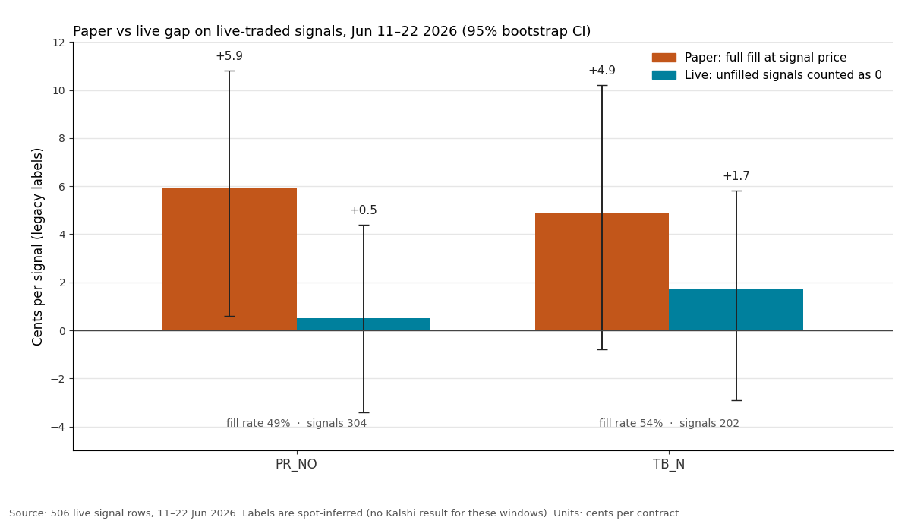
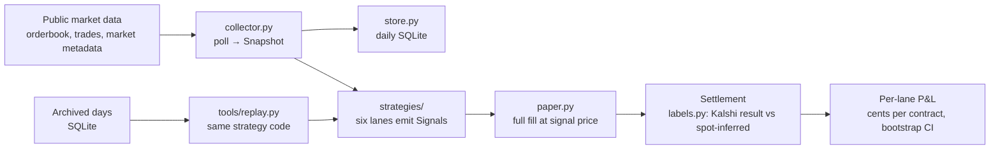

# Kalshi BTC 15-Minute Strategies: the audit that killed my own edge

I built a paper-trading system for Kalshi's 15-minute bitcoin markets and tested six strategy lanes on archived data. Before trusting the backtest, I checked its settlement labels against Kalshi's own official results. **7.95% of the labels were wrong**, and the errors clustered right at the strike, where several of the strategies trade. With corrected labels, every lane's P&L interval includes zero, and the lane that looked strongest turned negative. None of the strategies is shown to be profitable.

**At a glance**
- **84 of 1,056** settlement labels (7.95%) disagreed with Kalshi's result. Within 5 USD of the strike, 40% were wrong; beyond 100 USD, 1%.
- **REV01 (cheapest-side flip):** +33.5¢ per contract under the original labels, **−4.8¢** under Kalshi's results.
- **No corrected lane has a 95% interval that excludes zero.** The best estimate, PR_NO, is +3.0¢ with an interval of −2.5¢ to +8.7¢.
- **Paper vs live (PR_NO):** +5.9¢ per signal on paper, +0.5¢ live. Only 49% of signals filled, and 30% of live signals were cancelled by API errors.



## The problem in plain English

Each 15-minute market asks whether bitcoin will close above a set price (the strike). Settlement should follow Kalshi's official result. My early labels did not. They were inferred from the bitcoin spot price on Coinbase, and the two sources sometimes disagree.

Those wrong labels were wrong most often when the price finished close to the strike, which is exactly where several of the strategies trade. TB_N enters only within 75 USD of the strike, and REV01 only within 15 USD. A wrong label near the strike tells a strategy it won a bet it lost, or the reverse. That is how a weak strategy can look excellent in a backtest. REV01's win rate went from 46.6% under the original labels to 8.2% under Kalshi's results.

## Results

Full detail, method and caveats are in [RESULTS.md](RESULTS.md). Cents per contract; 95% bootstrap intervals over trades.

| Lane | Trades | Original labels | Kalshi-verified labels |
|---|---:|---:|---:|
| REV01 cheap flip | 73 | +33.5 [+22.5, +44.8] | −4.8 [−10.5, +2.1] |
| S01 late-window fade | 390 | +9.2 [+4.7, +13.7] | −1.5 [−5.4, +2.5] |
| TB_N stale wide crowded | 221 | +7.0 [+1.9, +11.8] | +0.7 [−5.0, +6.2] |
| PR_NO 50–70 book | 291 | +6.1 [+0.7, +11.5] | +3.0 [−2.5, +8.7] |
| TB_Q midwide YES-heavy fade | 281 | +2.1 [−3.2, +7.0] | −0.8 [−6.0, +4.3] |
| TA_L burst wide fade | 220 | −0.9 [−6.9, +4.8] | −2.3 [−8.1, +3.6] |

After an assumed fee (0.07 × P × (1 − P) per contract, from secondary sources), no lane is clearly positive. Paper results assume every order fills in full at the quoted price. Live fills were 49% for PR_NO, and the paper-to-live gap comes mainly from those missed fills.



## What I learned

- **Check your labels against the venue's own settlement before any backtest.** A plausible-looking edge can be a labelling artifact. Here it was.
- **Look at the interval, not the headline.** All six lanes have fewer than 400 trades, and every corrected interval is wide enough to include zero.
- **An observed price is not a fill.** Paper assumed every entry filled. Live filled about half, and the signals that did fill won less often (hint, not proof).
- **Keep the evidence.** The Kalshi results that corrected the labels can no longer be re-fetched from the public endpoint. The stored values are the only record, so the archive has to be preserved.

## Timeline

| Date (2026) | Milestone |
|---|---|
| Mar 25 | First archived 15-minute window |
| Jun 11 | First live fill logged (PR_NO) |
| Jun 11–22 | Live trading period: 506 signals across two lanes |
| Jun 22 | Kalshi results fetched for windows closing from this date onward |
| Jun 23 – Jul 4 | Twelve archived days relabelled from Kalshi's results; labels audited |
| Late Aug | Research code consolidated into the current package (file timestamps) |
| Aug 30 | Last collected day in the archive |

The date the full relabelling run was executed is not recorded in the archive, so the audit date is not given here.

## Architecture



## What's in the repo

```
btc15m/
  models.py           snapshot, signal and position types
  collector.py        turns a market poll into a Snapshot (read-only protocol)
  store.py            daily SQLite persistence
  paper.py            paper engine and settlement
  labels.py           original vs Kalshi-result labels, mismatch summary
  config.py           defaults only (no credentials, nothing read from disk)
  strategies/         six lanes: book fade, probability bucket, late fade, cheap flip
  client.py           STUB: signed API client omitted
  btcfeed.py          STUB: live BTC reference feed omitted
  live.py             STUB: live order execution omitted
  engine.py           STUB: live orchestration omitted
tools/replay.py       replays archived snapshots through the strategy code
scripts/reproduce.py  recomputes the label and P&L checks on the sample
data/sample/          three archived days with Kalshi-verified labels (CSV)
tests/                pytest checks
charts/               figures used above
RESULTS.md            full results and caveats
```

Omitted entirely: live order execution, signed API requests, credentials, deployment scripts, the dashboard, live collector data, and the earlier research history.

## Reproduce

```
pip install -r requirements.txt
python scripts/reproduce.py
python -m pytest -q
```

`reproduce.py` runs the same label and P&L checks on the three-day public sample. **The sample is not the headline dataset.** Three of the twelve relabelled days give a 5.8% mismatch rate instead of 7.95%, and some lane figures differ from the full results, including the sign for REV01. Use the sample to check the method; use [RESULTS.md](RESULTS.md) for the figures.

## How this was built

I designed the strategies, the checks and the review of every result against the raw data. The code was written with AI coding tools (Claude Code).

**Abhinay Kadam** · [LinkedIn](https://www.linkedin.com/in/abhinay-kadam/)
